<div align="center">

  <a href="https://coursing-stats.ru">
    
  </a>

  # CoursingStats

  **Единая кинологическая платформа спортивной статистики, выставок РКФ и замеров скорости**  
  *Open-source cynological analytics platform for sighthound sports, RKF shows and speed records*

  <p align="center">
    <a href="https://coursing-stats.ru">
      
    </a>
    <a href="https://github.com/antajl/Coursing-Stats/actions/workflows/deploy.yml">
      
    </a>
    <a href="https://t.me/coursing_stats_bot">
      
    </a>
    <a href="https://react.dev">
      
    </a>
    <a href="https://www.typescriptlang.org">
      
    </a>
    <a href="LICENSE">
      
    </a>
  </p>

  <p align="center">
    <a href="https://coursing-stats.ru">Веб-платформа</a> •
    <a href="https://coursing-stats.ru/shows">Выставки РКФ</a> •
    <a href="https://coursing-stats.ru/speed-records">Замеры Донино</a> •
    <a href="https://t.me/coursing_stats_bot">Telegram-бот</a> •
    <a href="docs/ROADMAP.md">Дорожная карта</a> •
    <a href="docs/MAP.md">Документация</a> •
    <a href="#открытые-данные-open-cdn">Открытый CDN</a>
  </p>

</div>

---

## О проекте

**CoursingStats** — открытая кинологическая аналитическая платформа и статистический архив. Проект объединяет результаты официальных состязаний борзых (курсинг, бега за механической приманкой, круговой трек с 2015 года), сертификатные выставки РКФ (2019–2026) и замеры спринтерской скорости в единую систему с поиском, рейтингами и профилями собак.

### Архитектурные принципы

- **Zero-Backend CDN (0ms Runtime):** Публичный сайт не выполняет запросов к базе данных при загрузке страниц. Клиентское приложение напрямую получает предрассчитанные сжатые JSON-пакеты из CDN Yandex Object Storage (`/data/v1/`).
- **Три изолированных домена:** Полная изоляция правил подсчета и архитектурных контуров для спорта (курсинг и бега), выставок РКФ и радарных испытаний в Донино. Смешивание метрик между доменами запрещено.
- **Две независимые рейтинговые системы в спорте:** Медальный зачет (подиумы) и система очков стабильности CS (качество и плотность забегов) рассчитываются параллельно и не подменяют друг друга.
- **Векторные протоколы РКФ:** Встроенный генератор эталонных печатных протоколов соревнований в векторный HTML и PDF по нормативам РКФ.
- **Serverless Telegram-бот:** Бот на базе Cloudflare Workers и Grammy с многоуровневым KV-кэшированием и отдачей карточек собак.
- **Old Money Design System:** Интерфейс в сдержанной песочно-бежевой палитре (Camel/Sand), типографика Montserrat, SVG-иконки Lucide и полный запрет на эмодзи в оформлении.
- **AI-Ready репозиторий:** Кодовая база структурирована для работы автономных AI-агентов (`AGENTS.md`, 13 предметных навыков в `.agents/skills/`, 17 инженерных шпаргалок в `docs/sheets/`).

---

## Масштаб платформы

| Направление | Объем данных | Особенности хранения и обработки |
|:---|---:|:---|
| Выставки РКФ | 60 000+ выставок | Архивы рингов за 2019–2026 гг. |
| Записи в протоколах рингов | ~18 000 000 записей | 51 000+ сжатых gzip протоколов на S3 CDN |
| Спортивные турниры (курсинг, бега, БЗМП) | 157 состязаний | Официальные турниры с 2015 года |
| Спортивные собаки в базе | 2 341 собака | Профили, родословные, история баллов |
| Результаты забегов | 9 082 записи | Детализация по пускам и судейским оценкам |
| Замеры скорости Донино | 300+ результатов | Радарная скорость (км/ч) и время 350 м (сек) |

---

## Архитектура и поток данных

```mermaid
flowchart LR
    subgraph Sources[1. Источники]
        P[procoursing.ru]
        R[Отчеты РКФ]
        D[Полигон Донино]
    end

    subgraph Pipeline[2. Пайплайн]
        Ingest[yarn ingest-competition]
        Parsers[Парсеры и валидация Zod]
        Build[yarn build-all-data]
    end

    subgraph Storage[3. Статический CDN]
        CDN[CDN /data/v1/ Yandex S3]
        Protocols[51k+ Gzip протоколов S3]
    end

    subgraph Clients[4. Интерфейсы]
        Web[React 19 + Vite]
        Bot[Telegram-бот Workers + KV]
    end

    Sources --> Pipeline --> Storage --> Clients
```



### Доменная структура

| Домен | Предметная область | Источники и алгоритмы |
|:---|:---|:---|
| **Соревнования (Sport)** | Курсинг, бега за механической приманкой (БЗМП), круговой трек. Профили собак, статистика судей, динамика забегов. | Данные 2015–2026 гг. Независимые зачёты: **Медали** (подиумы) и **Очки CS** (баллы за качество забегов). |
| **Выставки РКФ (Shows)** | Национальный выставочный рейтинг, протоколы рингов, профили экспертов-судей и архивы (CAC, CACIB, моно). | Оцифровка официальных PDF-отчетов РКФ. База из 1.5+ млн собак, расчет годовых рейтингов по породам и группам FCI. |
| **Донино (Speed)** | Фиксация спринтерских рекордов борзых на специализированной трассе в Донино. | Радарные замеры максимальной скорости (**км/ч**) и время дистанции 350 м (**секунды**). |

---

## Открытые данные (Open CDN)

Платформа предоставляет доступ к сформированным кинологическим индексам без API-ключей и авторизации:

```bash
# Топ-100 собак в общем зачёте выставок РКФ:
curl -s https://coursing-stats.ru/data/v1/shows/indexes/dog-ranking-all-time-page0.json | jq '.[0]'

# Профиль спортивной собаки со стартами и титулами:
curl -s https://coursing-stats.ru/data/v1/dogs/by-id/721.json

# Спринтерские рекорды пород (Донино):
curl -s https://coursing-stats.ru/data/v1/donino/speed-records.json
```

---

## Стек технологий

- **Фронтенд:** React 19, TypeScript, Vite, Tailwind CSS, TanStack React Query, GSAP, Lucide Icons.
- **Пайплайн данных:** Node.js, TSX, Vitest, Cheerio, ExcelJS, PDF parsing (pdfjs, paddle-ocr), Zod.
- **Инфраструктура:** Yandex Object Storage (Static CDN S3), Cloudflare Workers & KV, GitHub Actions CI/CD.

---

## Быстрый старт

### Требования

- Node.js >= 20.x
- Yarn 1.22.22

### Локальная разработка

```bash
# 1. Клонирование репозитория
git clone https://github.com/antajl/Coursing-Stats.git
cd Coursing-Stats

# 2. Установка зависимостей
yarn install

# 3. Запуск сервера разработки (Vite)
yarn run dev
```

Приложение доступно по адресу `http://localhost:5173`. Данные загружаются напрямую из продакшен CDN.

<details>
<summary><strong>Команды обработки данных и тестирования</strong></summary>

```bash
# Ввод турнира с автоматическим сопоставлением собак:
yarn ingest-competition <path-to-draft.json>

# Экспорт векторного протокола РКФ (HTML/PDF):
yarn export-protocol <eventId> [outDir]

# Полная пересборка индексов и проверка publish-gates:
yarn run build-all-data

# Запуск тестов алгоритмов и компонентов:
yarn test

# Проверка фикстур парсеров:
yarn run test-parser-fixtures
```

</details>

<details>
<summary><strong>Разработка и деплой Telegram-бота</strong></summary>

```bash
cd bot
yarn install
yarn test
yarn run dev     # локальный запуск через Miniflare
yarn run deploy  # деплой в Cloudflare Workers
```

</details>

---

## Документация

- **[ROADMAP.md](docs/ROADMAP.md)** — Стратегический план развития и 4 ветки рефакторинга.
- **[MAP.md](docs/MAP.md)** — Маршрутизатор по кодовой базе («Задача → 1 файл»).
- **[Архитектурные решения (ADR)](docs/decisions/)** — Инженерные решения и их обоснование (ADR-001 — ADR-016).
- **[Шпаргалки по разделам](docs/sheets/)** — 17 технических руководств по компонентам системы (00–16).
- **[AGENTS.md](AGENTS.md)** — Правила и системный контекст для работы AI-ассистентов.

---

## Лицензия

Проект распространяется под лицензией MIT. Подробности в файле [LICENSE](LICENSE).
