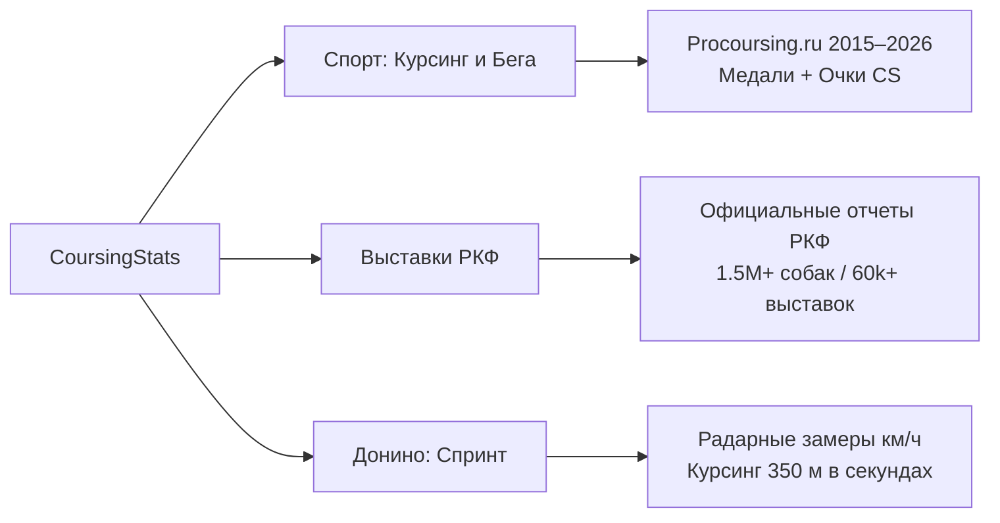

<div align="center">

  

  # CoursingStats

  **Единая кинологическая платформа спортивной статистики, выставок РКФ и замеров скорости**  
  *Open-source cynological analytics platform for sighthound sports, RKF shows and speed records*

  <p align="center">
    <a href="https://coursing-stats.ru"><strong>coursing-stats.ru »</strong></a>
    <br />
    <br />
    <a href="https://coursing-stats.ru">
      
    </a>
    <a href="https://t.me/coursing_stats_bot">
      
    </a>
    <a href="https://github.com/antajl/Coursing-Stats/actions">
      
    </a>
    <a href="https://react.dev">
      
    </a>
    <a href="https://www.typescriptlang.org">
      
    </a>
    <a href="LICENSE">
      
    </a>
  </p>

  <p align="center">
    <a href="https://coursing-stats.ru">Веб-сайт</a> •
    <a href="https://t.me/coursing_stats_bot">Telegram-бот</a> •
    <a href="docs/ROADMAP.md">Дорожная карта</a> •
    <a href="docs/MAP.md">Документация</a> •
    <a href="https://coursing-stats.ru/data/v1/">Открытый CDN</a>
  </p>

</div>

---

## О проекте

**CoursingStats** — открытая кинологическая аналитическая платформа и агрегатор спортивной статистики в России. Проект объединяет результаты официальных состязаний борзых (2015–2026), национальные выставки Российской кинологической федерации (РКФ) и замеры спринтерской скорости в единую систему с поиском, рейтингами и профилями собак.

### Ключевые возможности:

- **Zero-Backend CDN (0ms Runtime):** Публичный сайт не использует базу данных во время выполнения. Клиентское приложение напрямую загружает структурированные сжатые JSON-пакеты через CDN Yandex Object Storage (`/data/v1/`).
- **Три изолированных домена:** Независимые правила подсчета и архитектурные контуры для спорта (курсинг и бега), выставок РКФ и радарных испытаний в Донино.
- **Две спортивные рейтинговые системы:** Медальный зачет (подиумы) и система очков стабильности CS (качество и плотность забегов) рассчитываются строго независимо.
- **Векторные протоколы:** Автоматический экспорт и верстка эталонных официальных протоколов соревнований в векторный HTML и PDF по стандартам РКФ.
- **Serverless Telegram-бот:** Бот на базе Cloudflare Workers и Grammy с поиском по кличкам, карточками участников и уведомлениями.
- **Old Money Design System:** Строгий интерфейс без визуального шума в теплой бежево-песочной палитре с типографикой Montserrat и SVG-иконками Lucide.

---

## Архитектура трёх доменов



| Домен | Что отслеживает | Источники и алгоритмы |
|---|---|---|
| **Соревнования (Sport)** | Курсинг, бега за механической приманкой (БЗМП), круговой трек. Профили собак, статистика судей, динамика забегов. | Данные 2015–2026 гг. Независимые зачёты: **Медали** (подиумы) и **Очки CS** (баллы за качество забегов). |
| **Выставки РКФ (Shows)** | Национальный выставочный рейтинг, протоколы рингов, профили экспертов-судей и архивы (CAC, CACIB, моно). | Парсинг официальных PDF-отчетов РКФ. База из более чем 1.5 млн собак и расчет годовых рейтингов по породам и группам FCI. |
| **Донино (Speed)** | Фиксация спринтерских рекордов борзых на специализированной трассе в Донино. | Радарные замеры максимальной скорости (**км/ч**) и прохождение дистанции курсинга 350 м (**секунды**). |

---

## Масштаб платформы

| Показатель | Значение |
|---|---|
| Спортивные турниры | 157 состязаний (2015–2026) |
| Спортивные собаки в базе | 2 341 собака |
| Результаты забегов в протоколах | 9 082 записи |
| Выставки РКФ | 60 000+ выставок |
| Записей в протоколах рингов | ~18 000 000 записей |
| Замеры скорости Донино | 300+ официальных результатов |

---

## Архитектура и технические решения

- **CDN Packs Pattern (ADR-014):** Профили собак и судей упаковываются в блочные шарды (`pack-*`), что исключает генерацию сотен тысяч мелких сетевых запросов.
- **Edge SQLite (Turso):** Протоколы рингов выставок хранятся в распределенной базе Turso (libSQL) и запрашиваются клиентом по требованию в режиме fallback.
- **Serverless Telegram Bot:** Бот развернут в Cloudflare Workers с многоуровневым KV-кэшированием и отдачей легковесных карточек.
- **AI-First архитектура:** Кодовая база снабжена контекстными инструкциями для AI-ассистентов (`AGENTS.md`, каталог `.agents/skills/`, 17 инженерных шпаргалок в `docs/sheets/`).

---

## Стек технологий

- **Frontend:** React 19, TypeScript, Vite, Tailwind CSS, TanStack React Query, GSAP, Lucide Icons.
- **Pipelines & Data:** Node.js, TSX, Vitest, Cheerio, ExcelJS, PDF parsing (pdfjs, paddle-ocr), Zod.
- **Infrastructure:** Yandex Object Storage (Static CDN), Turso (libSQL/SQLite), Cloudflare Workers, GitHub Actions CI/CD.

---

## Быстрый старт

### Требования

- Node.js >= 20.x
- Yarn 1.22.22

### Установка и запуск

```bash
# 1. Клонирование репозитория
git clone https://github.com/antajl/Coursing-Stats.git
cd Coursing-Stats

# 2. Установка зависимостей
yarn install

# 3. Запуск локального сервера разработки (Vite)
yarn run dev
```

Фронтенд будет доступен по адресу `http://localhost:5173`.

<details>
<summary><strong>Команды обработки данных и тестирования</strong></summary>

```bash
# Безопасный ввод турнира с автосопоставлением собак:
yarn ingest-competition <path-to-draft.json>

# Экспорт эталонного векторного протокола (HTML/PDF):
yarn export-protocol <eventId> [outDir]

# Полная пересборка всех индексов и проверка publish-gates:
yarn run build-all-data

# Запуск тестов бэкенда и алгоритмов (46 тест-сьютов):
yarn test

# Тестирование фикстур парсеров:
yarn run test-parser-fixtures
```

</details>

<details>
<summary><strong>Запуск и деплой Telegram-бота</strong></summary>

```bash
cd bot
yarn install
yarn test
yarn run dev     # локальный запуск
yarn run deploy  # Cloudflare Workers деплой
```

</details>

---

## Документация

- **[ROADMAP.md](docs/ROADMAP.md)** — Дорожная карта и 4 стратегические ветки развития.
- **[MAP.md](docs/MAP.md)** — Маршрутизатор по кодовой базе и задачам.
- **[Архитектурные решения (ADR)](docs/decisions/)** — История и контекст инженерных решений (ADR-001 — ADR-014).
- **[Шпаргалки по разделам](docs/sheets/)** — 17 подробных технических документов (00–16).

---

## Лицензия

Проект распространяется под лицензией MIT. Подробности в файле [LICENSE](LICENSE).
