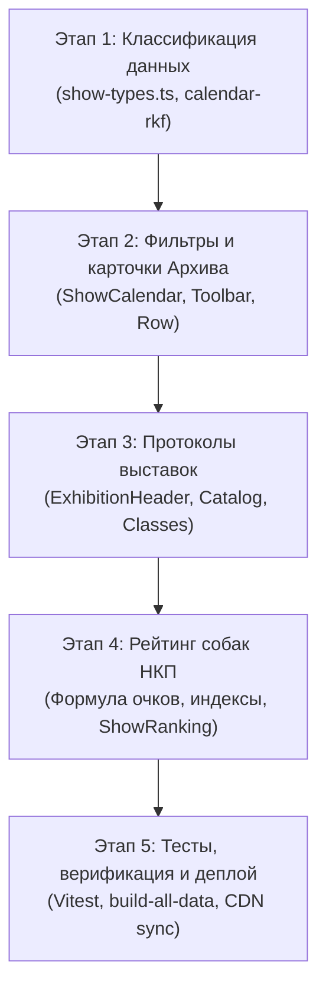

# Архитектурный план: Разделение Всепородных и Монопородных выставок РКФ

> **Статус:** Утверждён к реализации  
> **Дата:** 22 ноября 2026 г.  
> **Область:** Выставки РКФ (`/shows/` — Архив, Рейтинг, Протоколы, Индексы)  
> **Прямая аналогия:** Разделение дисциплин «Курсинг» и «Рейсинг» в разделе «Соревнования» (`/competitions/`).

---

## 1. Концепция и обоснование

В разделе **«Соревнования»** (`/competitions/`) исторически и архитектурно заложено разделение на две независимые дисциплины:
- **Курсинг** (поле, баллы за маневренность, азарт и выносливость, 2 круга);
- **Рейсинг** (круговой трек, боксы, чистое время в секундах, заезды).

Они сведены в единую систему с возможностью:
1. Смотреть общий срез или фильтровать календарь/архив по дисциплинам (`?discipline=coursing` / `?discipline=racing`);
2. Иметь отдельные зачёты в рейтинге (`TopDogs`: зачёт курсинга и зачёт рейсинга с переключением на мобильных устройствах и независимыми очками).

### Проблема текущего состояния выставок:
В выставках РКФ происходит смешение двух принципиально разных форматов:
1. **Всепородные выставки (САС / CACIB / ЧРКФ):** Масштабные шоу-мероприятия (10 групп FCI, 200+ пород), где разыгрываются титулы групп (BIG 1–10) и общий Best in Show (BIS).
2. **Монопородные выставки (НКП: ЧК / ПК / КЧК / КЧК-ВКК / ПП):** Зоотехнические смотры Национальных клубов пород под судейством узких экспертов-породников. Групп FCI здесь нет в принципе, но разыгрываются уникальные селекционные титулы НКП (`ЧК`, `ПК`, `КЧК`, `СС`, `ЮСС`, `BISS`).

**Текущее искажение:**  
В формуле подсчета очков победы в Бестах групп (BIG = 5 000) и общем Бесте выставки (BIS = 10 000) подавляют монопородные заслуги (`КЧК` = 35). Собака, победившая на 5 монопородках подряд под строжайшими породниками, в общем рейтинге уступает собаке, один раз зашедшей в призы в слабой группе на сельской всепородке.

### Решение:
Внедрить гармоничную трехуровневую систему аналогично разделу соревнований:
- **Общий зачёт / Все выставки** (`scope=all`);
- **Всепородный зачёт (САС / CACIB)** (`scope=all_breed`);
- **Монопородный зачёт (НКП / КЧК)** (`scope=mono`).

---

## 2. Архитектура данных и классификация (Data Layer)

### 2.1. Классификация выставок (`backend/lib/show-types.ts`)
Каждая выставка в системе строго типизируется:

```typescript
export type ShowExhibitionScope = 'all_breed' | 'mono' | 'specialty'

export interface ShowScopeMeta {
  scope: ShowExhibitionScope
  isMono: boolean
  isSpecialty: boolean
  nkpName?: string | null
  targetBreed?: string | null
}
```

**Критерии классификации:**
- **`mono`:**
  - Наличие `national_breed_club_name` (напр. «НКП САЛЮКИ»);
  - Или ранги содержат `КЧК`, `ЧК`, `ПК`, `ПП`, `КЧК В КАЖДОМ КЛАССЕ`, `ПОБЕДИТЕЛЬ КЛУБА ГОДА`;
  - Или в протоколе `breed_catalog` состоит из 1 базовой породы (плюс её ростовые/шерстные разновидности);
  - В РКФ отчетах: всегда 0 ведомостей Type 3 (BIS/BIG отсутствуют).
- **`specialty`:**
  - Всепородная выставка ранга CACIB или ЧРКФ ОС, в рамках которой официально заявлены спешиалти-ринги НКП с присуждением КЧК.
- **`all_breed`:**
  - Все остальные сертификатные выставки (САС ЧРКФ, САС ЧФ, САС групп пород, CACIB без спешиалти).

### 2.2. Обогащение индексов
1. `data/v1/shows/calendar-rkf/{year}.json` и `available-exhibitions.json`:
   - Добавление атрибута `scope: 'all_breed' | 'mono' | 'specialty'`.
2. `data/v1/shows/indexes/breed-calendar/{year}.json`:
   - Разделение индексов или метаданные по типу участия:
     - `breed-calendar/{year}.json` (все выставки породы);
     - `breed-calendar-mono/{year}.json` (только монопородные выставки породы).

---

## 3. Архив и Календарь (`/shows/archive/`)

### 3.1. Тулбар архива (`ShowCalendarToolbar.tsx`)
Добавление переключателя формата выставки по стандарту Old Money Design System:

- **Десктоп:** Тройной переключатель в едином стиле тулбара:
  `[ Все выставки ]  [ Всепородные (САС) ]  [ Монопородные (НКП) ]`
- **Мобильный тулбар:** Компактный чип-фильтр с выпадающим меню или toggle:
  `Формат: Все ▾` / `Формат: Моно ▾` / `Формат: САС ▾`.
- **URL-параметр:** `?scope=all` | `?scope=mono` | `?scope=all_breed` (с сохранением чистого URL по умолчанию).

### 3.2. Логика совместной фильтрации «Порода + Формат» (`showCalendarDate.ts`)
- **Порода (напр. Салюки) + `scope=mono`:**  
  Показывает исключительно специализированные монопородные выставки салюки (рангов КЧК, ЧК, ПК) по всей стране.
- **Порода (Салюки) + `scope=all`:**  
  Показывает все выставки, где участвовали салюки (и всепородные САС, и моно).
- **Порода не выбрана + `scope=mono`:**  
  Показывает полный календарь всех 6 950 монопородок сезона с фильтрацией по городам и месяцам.

### 3.3. Разрешение скрытия монопородок внутри клубных групп (`showCalendarGroup.ts`)
**Проблема:** При объединении выставок одного клуба за день (`rkfClubMergeKey`) всепородная САС по умолчанию перебивала монопородки и вставала в шапку карточки группы.  
**Новое правило:**
- Если активен фильтр `scope=mono` ИЛИ выбрана конкретная порода:
  Заглавной выставкой карточки группы выбирается **монопородка этой породы** (название НКП, ранг КЧК/ЧК), а всепородная САС либо исключается, либо сворачивается в дочерние элементы.

### 3.4. Визуальный язык карточки (`ShowCalendarRow.tsx`)
- **Монопородки:**
  - Акцентный статусный бейдж: `МОНОПОРОДНАЯ ВЫСТАВКА` (терракота / теплое золото `bg-camel-100 text-camel-900 border-camel-300`);
  - Подзаголовок: `НКП: {Название}` жирным шрифтом в Sentence Case;
  - Чипы рангов клуба: `КЧК`, `КЧК в каждом классе`, `ПК`, `ЧК`.
- **Всепородные:**
  - Классический бейдж: `САС ЧРКФ` / `CACIB` / `ЧРКФ ОС`.

---

## 4. Страница протокола выставки (`/shows/exhibition/:id/`)

### 4.1. Адаптивная шапка (`ExhibitionHeader.tsx`)
- Для монопородной выставки:
  - Крупный бейдж: `Монопородная выставка · НКП [Название НКП]`;
  - Плашка «Пород: 1» (вместо длинных списков);
  - Удаление блока групп FCI (для монопородки они неприменимы).

### 4.2. Секция каталога и результатов (`CatalogResultsSection.tsx`)
- Скрытие фильтра 10 групп FCI при `scope === 'mono'`;
- Поддержка и акцент на специфических классах НКП:
  - **Класс победителей** (с 15 месяцев);
  - **Класс чемпионов НКП** (для собак с оформленным ЧНКП).
- Подсветка сертификатов соответствия: `СС`, `ЮСС`, `ВСС`.

### 4.3. Финальный ринг (`MainRingSection.tsx`)
- На всепородных: стандартные вкладки BIG 1..10 и BIS (из Type 3 PDF).
- На монопородных: блок **BISS (Best in Specialty Show)** и специализированные конкурсы питомников, пар и производителей.

---

## 5. Разделение Рейтинга собак (`/shows/ranking/`)

### 5.1. Формула подсчета очков для Монопородного рейтинга
В монопородном зачете исключаются всепородные Бесты групп (`BIG`) и общий `BIS`.

**Таблица весов монопородного зачёта:**
- `ЧК` (Чемпион Клуба — победитель главной выставки года НКП): **3 000**
- `ПК` (Победитель Клуба / Победитель породы года): **1 800**
- `BISS / BIS Моно` (Лучшая собака монопородной выставки): **1 500**
- `КЧК` / `КЧК-ВКК` (Кандидат в чемпионы клуба): **600**
- `ЮЧК` / `ЮПК` / `ЮКЧК` (Юниорские клубные титулы): **450**
- `ВЧК` / `ВПК` / `ВКЧК` (Ветеранские клубные титулы): **400**
- `CW` (Победитель монопородного класса): **200**
- `СС` (Сертификат соответствия НКП): **100**
- `ЮСС` / `ВСС`: **70**

### 5.2. Генерация раздельных индексов (`build-show-indexes-by-year.ts`)
Пайплайн генерирует 3 независимых файла на каждый сезон:
1. `dog-ranking-{year}.json` (Общий объединенный рейтинг);
2. `dog-ranking-{year}-cac.json` (Всепородный зачёт: САС / CACIB / Бесты групп);
3. `dog-ranking-{year}-mono.json` (Клубный зачёт НКП: чистые монопородные заслуги).

Для быстрого первого экрана формируются соответствующие `-page0.json` срезы.

### 5.3. Интерфейс рейтинга (`ShowRanking.tsx`)
В верхней панели рейтинга появляется переключатель дисциплин/зачетов (полная аналогия с `TopDogs` в спорте):
`[ Все выставки ]  [ Всепородный зачёт ]  [ Клубный зачёт (НКП) ]`

В карточке собаки при активном клубном зачете выводятся бейджи `ЧК`, `ПК`, `КЧК`, `BISS`, отображая реальную племенную ценность собаки для заводчиков.

---

## 6. Пошаговые этапы реализации (Checklist)



- [x] **Этап 1. Слой данных:**
  - Создать `backend/lib/show-types.ts` и тесты классификации.
  - Обогатить `calendar-rkf/*.json` признаком `scope`.
- [x] **Этап 2. Архив и Календарь:**
  - Реализовать контроллер выбора формата в `ShowCalendarToolbar.tsx`.
  - Обновить `showCalendarDate.ts` (фильтрация по `scope`).
  - Доработать `showCalendarGroup.ts` (приоритет монопородок в группах).
  - Стилизовать бейджи `МОНО` и плашки НКП в `ShowCalendarRow.tsx`.
- [x] **Этап 3. Протоколы выставок:**
  - Доработать шапку `ExhibitionHeader.tsx` для монопородок.
  - Локализовать классы победителей и чемпионов НКП в `CatalogResultsSection.tsx`.
- [x] **Этап 4. Рейтинг собак:**
  - Создать формулу очков `showMonoRankScore` в `backend/lib/show-awards/score.ts`.
  - Добавить переключатель зачёта в `ShowRanking.tsx`.
- [x] **Этап 5. Верификация:**
  - Написать тесты на разделение выставок и расчет монопородных очков.
  - Запустить `yarn test:fast`.
  - Зафиксировать инвариант в `docs/invariants/shows-rkf.md`.
